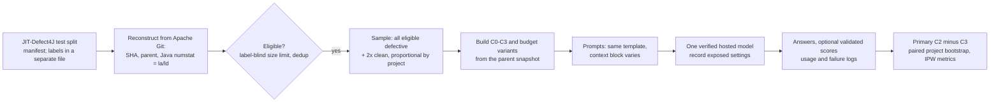

# D. Experimental Design Proposal

Status: **revision 3.2 proposal**, 2026-10-20. The user requested the pre-pilot corrections and primary C2−C3 comparison after the independent audit. This is not a frozen protocol: Prof. Höll must approve the inference target, metrics, sampling and statistical choices at Gate 4. C0–C3 and the Python architecture are retained. No LLM inference has occurred; earlier test-data exposure is recorded in [02-datasets.md](02-datasets.md) §8. Changes are indexed in [README.md](README.md). Evidence labels: **[V]** verified, **[I]** interpretation or recommendation, **[A]** assumption. New implementation checks are distinguished from historical measurements.

## 0. Design principles

1. **Compare specified strategies.** Every condition shows the identical diff. C2−C3 compares two selection policies from one pool at approximately matched volume; C2−C1 also changes pool, chunking and ranking. Neither isolates semantic relevance or file location alone.
2. **Same commits, same model settings, same template** across conditions (a within-subject design).
3. **Separate information from volume.** All context blocks share one token budget, and a token-matched random control is required (see [01-literature-review.md](01-literature-review.md) §7).
4. **Plan for uncertainty.** Report paired effect estimates and project-aware intervals. Equivalence requires a justified margin fixed before test inference; non-significance alone is inconclusive.
5. **Simplest operationalization first.** Git plumbing, tree-sitter-java for method boundaries, and BM25; dependency analysis only if the pilot shows it is needed.
6. **Context is fixed before the call.** One non-agentic prompt per condition, so the effect of *what* the model sees is not mixed up with *how* an agent searches. This is the main methodological difference from JIT-LSM (Huang2026), whose agent chooses its own same-file context ([01-literature-review.md](01-literature-review.md) §5).

## 1. Critique of the provisional research questions

| Provisional RQ | Issue | Refinement |
|---|---|---|
| RQ1: local *or* repository context vs diff only | Two different manipulations in one question, and "effectiveness" is not operationalized. Revision 1 compared each source only with C0, although the brief also asks whether relevant repository context beats *local* code | Three pre-specified contrasts (C1−C0, C2−C0, C2−C1) at one shared token budget, with a named primary metric |
| RQ2: relevant vs random context | "Relevance" is only as good as the retriever; volume must be matched and residual errors logged | Make the operational BM25−random comparison primary; bounded blinded audit and per-instance ±2% token matching |
| RQ3: quality, tokens, cost, *and* models | Bundles three questions. The brief names *quantity* as part of the primary independent variable, but revision 1 treated the budget only as an optional ablation | RQ3: quantity and cost (a planned budget series). Model dependence becomes a secondary robustness analysis (SA1), not a research question |
| (missing) | No mechanism: *for which changes* should context help? | Exploratory question EQ1 on change characteristics |

## 2. Refined research questions and hypotheses

- **RQ1 – Context effectiveness and strategy.** Compared with the unified diff alone (C0), how does adding same-file local context (C1) or BM25-selected cross-file repository context (C2) change LLM defect-prediction performance? At an equal token budget, does the BM25 cross-file strategy outperform the proximity same-file strategy?
  - H1a (C1−C0), H1b (C2−C0), and H1c (C2−C1) are **secondary paired estimates**, with intervals, not three additional confirmatory tests (§11).
  - H1c compares two *strategies* that differ in pool and in ranking. It is not a test of code location alone (§5.6).
- **RQ2 – Selection policy at matched volume (primary).** At a per-instance matched token count, how does BM25-selected cross-file context change performance relative to randomly selected cross-file context from the same snapshot?
  - **Sole primary contrast: C2−C3**, M1, B = 2,000, seed 0; two-sided. Metric selection is conditional on the access/scoring check (§§7, 10). The retained RQ numbering does not imply priority.
  - The bounded audit (§5.7) assesses reviewer relevance. Lexical overlap is a manipulation diagnostic, not independent evidence of semantic usefulness. Era, subsystem and memorization cues may differ between C2 and C3.
  - Accounting identity, **not a causal decomposition**, only on identical commits/weights: $\Delta(C2-C0) = \Delta(C2-C3) + \Delta(C3-C0)$. It need not hold for separate pairwise-valid populations. C2−C3 is "BM25 versus random selection from the same pool at matched size"; C3−C0 adds randomly chosen code, mixing length and any information it carries.
- **RQ3 – Quantity and cost.** How do performance, input tokens, USD cost, and latency change when the cross-file budget grows from 1,000 to 2,000 to 8,000 tokens, for relevance-selected (C2) and random (C3) context? Does the relevance gap C2−C3 grow or shrink with the budget, and what does each +0.01 AUC cost?
- **SA1 (secondary analysis) – Model dependence.** Do the RQ1 and RQ2 effects hold in sign and size for a second, independent model, and for a third if the budget allows? This tests robustness; it is not a research question.
- **EQ1 (exploratory)** – Which change characteristics moderate the benefit of context? Candidates: size, number of files, whether method signatures or public API changed, test-only changes, formatting-only changes, and the size of the same-file pool.

## 3. Pipeline overview



Eligibility (§8) depends only on reconstruction and input sizes. It is computed for every test commit before labels are joined, although its effect on prevalence must be reported.

## 4. Task and prompt

- **Task and construct.** The model answers whether a Java change introduces a defect. Evaluation measures agreement/discrimination against `is_buggy_commit`, an **observed SZZ-derived proxy**, not verified defect truth. Manual validation of fixing lines does not validate every inducing commit or clean label. Context can expose a pre-existing fault and improve agreement for the wrong reason. No primary relabelling or exclusion is based on manual judgement; the bounded validation audit is in [02-datasets.md](02-datasets.md) §2a. The unit is one commit.
- **Input scope: Java files except `package-info.java` (a documented scope decision).** The diff and all context use `git diff ... -- '*.java' ':(exclude)*package-info.java'`.
  - Evidence [V, all 27,319 commits]: with this scope Git reproduces the benchmark's `la/ld` for 99.98% of commits in every split. Counting all files matched only 68.5% of a validation sample, and counting `package-info.java` left 195 commits unmatched ([02-datasets.md](02-datasets.md) §2).
  - This shows how the benchmark defines its *change metrics*. It does not show that non-Java changes are irrelevant to the labels.
  - The scope is chosen because it matches the benchmark's definition of the change, JIT-LSM and JIT-Defect-Extended use the same scope, and non-Java text such as `changes.xml` release notes would act like a commit message.
  - Consequence: 31.5% of a validation sample also changed non-Java files that the model never sees [V]. The task is therefore "predict from the Java change", and the thesis must say so.
- **Excluded from all prompts:** commit message, author, dates, JIRA keys, the `classification` and `fix` fields, Kamei metrics, line labels, and every field of JIT-Defect-Extended or JIT-LSM records. File paths stay because they are part of the diff.
  - [I] Rationale: the brief defines C0 as *diff only*; issue keys in messages are a memorization cue; and messages are a known strong predictor that would shrink the headroom for code context.
  - Consequence: absolute results are not comparable with JIT-LSM, whose prompts include the message, author, and date [V, code]. Within-model contrasts answer the narrower code-only question and remain exposed to context-dependent shortcuts.
- **Draft template (pilot):**

```text
[system]
You are an experienced Java engineer reviewing a commit. Decide whether the code change
introduces a defect, i.e. a bug that will later have to be fixed.

[user]
### Additional code from the repository (read-only; version BEFORE the change; may be irrelevant)
{context_block or "(none)"}

### Code change (unified diff of .java files, parent -> commit)
{diff}

### Answer
Answer with exactly one word: YES if the change introduces a defect, otherwise NO.
```

- **The block header is identical in every condition.** Each snippet carries its own `// <path> lines a-b` header, so the model can see whether code comes from a changed file or another file.
- **Block order is fixed:** instructions → context → diff → question. The diff sits next to the question in every condition, so the diff-to-question distance stays constant. Within the block, the highest-ranked snippet comes last, next to the diff. [I, motivated by Liu2024]
- **Scoring (validated in the pilot before it becomes primary).**
  - The score is the model's relative likelihood of the two answers at the answer position, $p=\frac{P_{YES}}{P_{YES}+P_{NO}}$, summing case and whitespace variants of each answer.
  - **Both candidates must be measured, not assumed.** A top-k list, even with k ≥ 5, does not guarantee that YES and NO both appear. Acceptable methods, in order of preference:
    1. A hosted API that returns the log-probabilities of both answer tokens at the answer position (exact). Inference uses hosted cloud APIs only; local model hosting is ruled out (user decision, 2026-10-19).
    2. An API with a logit-bias option, applying the *same* bias to exactly the two answer tokens, so both appear in the returned list while their ratio is unchanged [I; must be verified per API].
    3. An API whose top-k list contains both candidates for at least 98% of pilot prompts.
  - The method is fixed per model in the pilot. A missing two-candidate score is a **score failure**, distinct from a valid binary answer. Preserve both statuses; never replace a missing score with 0 or a missing answer with NO (§11).
  - **Pre-specified fallback:** if two-candidate scores are unavailable or valid for fewer than 98% of prompts in any core condition in the engineering pilot, the proposed primary metric becomes MCC (IPW) on emitted binary answers. This is recorded on validation data and requires D13 approval before any test call.
  - For binary metrics, parse the emitted YES/NO answer. If a likelihood-derived decision $[p\ge 0.5]$ is also reported, label it separately and report disagreement. Do **not** tune either threshold on test data. The relative answer likelihood is a discrimination score, not a calibrated defect probability.
  - Do **not** use verbalized confidence as a probability (Xiong2024).
- **Rationale subset (pilot, plus 10% of the main run):** a *separate* run in which the answer line becomes "YES or NO on the first line, then ≤ 40 words of justification". The template differs, so these runs are excluded from the confirmatory metrics. Use them only for qualitative error analysis and for the issue-key contamination check (§6).

## 5. Context conditions

Every condition contains the identical C0 diff, `git diff -U3 -M <parent> <commit> -- '*.java' ':(exclude)*package-info.java'`. B is the shared context budget: **2,000 tokens, o200k_base (decision D9)**.

| ID | Context block | Pool (parent snapshot) | Selection | Size |
|---|---|---|---|---|
| **C0** | none | — | — | 0 |
| **C1 local** | Same-file code: the parent version of each changed Java file, with every line already shown in the diff replaced by a marker | Changed files (old paths) | Lines of the enclosing methods first, then by distance from the change | ≤ B |
| **C2 repository, relevant** | 40-line windows from other Java files | Parent `.java` files minus all changed files | BM25 over identifiers in the changed lines | ≤ B |
| **C3 repository, random** | As C2 | As C2 | Seeded uniform random | T(C2) ± 2% |
| C2@b, C3@b (RQ3, M1 only) | As C2 / C3 | As C2 / C3 | As C2 / C3 | b ∈ {1,000; 8,000} |

**Why B = 2,000, and what it costs** [V, all 5,465 validation commits; [04-feasibility-demo.md](04-feasibility-demo.md) §5.6]:

- The masked same-file pool (license header stripped) holds at least 2,000 tokens for 69.4% of validation commits (clean 68.1%, defective 83.5%); at least 1,000 for 81.2%; at least 4,000 for 52.4%; it is empty for 5.1%. In a sample with one third defective commits, C1 can be filled to 2,000 tokens for about 73% of commits and to 1,000 for about 84%. Phase 2's 4-project figures (83–86%) were too optimistic.
- B = 2,000 is kept because the relevance contrast C2−C3 does not depend on the same-file pool, and because the enclosing methods alone had a median of 634 (random) and 1,103 (defective) tokens in the Phase 2 sample. The price is that C2−C1 can be compared at equal size on only about 73% of commits (§5.6, §11). B = 1,000 would raise that share to about 84% but halve the context; this is decision D9.
- Larger cross-file budgets are covered by RQ3.

### 5.1 Rules shared by all context conditions

- **Snapshot.** All code is read from `<parent>` via `git ls-tree -r` and `git cat-file --batch`; no checkout.
- **Preprocessing.** Strip each file's leading license or comment header (everything before `package`; in a default-package file without a `package` line, the leading comments and blank lines) and normalise line endings. The default-package case was found in the 2026-10-20 relevance inspection: a licence block in `src/test/maxima/.../RealFunctionValidation.java` was the top C2 window of a pilot commit.
- **Filling and token accounting** (implemented in [../src/jitctx/select.py](../src/jitctx/select.py) and [../src/jitctx/local.py](../src/jitctx/local.py)). Budgets and matches are counted on the *rendered* block (snippet headers, markers, and code), never as a sum of separately counted snippets, with o200k_base as the reference tokenizer so that every model receives identical text. Provider-reported tokens are logged separately for cost. Units (lines for C1, windows for C2 and C3) are added in rank order. A unit that does not fit is cut at a line boundary; if not even its first line fits, it is **skipped and the next unit is tried** (the second audit showed that stopping there left C2 empty when one huge line ranked first). Each block gets a status:
  - `ok`: within 2% below the target;
  - `line_limit`: below that, and at least one unit could not be fitted (the count of skipped units is logged);
  - `short`: the eligible units ran out without any size failure;
  - `no_hits`: C2 only, no window scored above 0 (C3 is then empty too);
  - `empty_pool`: nothing to select from.

  Tests: [../tests/](../tests/), including the audit's reproduction case.
- **Rendering.** Each C2/C3 snippet is `// <path> lines a-b` followed by the code. Snippets are grouped by file, in line order within a file, and files are ordered so that the file with the best-ranked snippet comes last, next to the diff. C1 lists the changed files in diff order; each run of selected lines has the same header, and each masked run that borders a selected line becomes one marker line, `// <path> lines a-b: shown in the diff`.
- **Empty pools.** If a pool is empty, the block is "(none)" and the instance is flagged, so its prompt equals C0's. This applies to C1 when the changed files are new or already shown in full by the diff (3.5% of random and 5.0% of defective validation commits [V]), and to C2/C3 when every BM25 score is 0.

### 5.2 C1: same-file local context

1. **Masking prevents duplication.** Collect the parent-side line numbers of every hunk in the C0 diff, including the three context lines. These lines are never repeated (marker lines, §5.1).
2. **Enclosing lines** are the lines of the innermost method, constructor, compact constructor, or static or instance initializer that contains a *changed* parent line, found with tree-sitter-java (pinned in [../requirements.txt](../requirements.txt)). Changed parent lines are the deleted lines and, for a pure insertion, the parent lines directly before and after it; context lines do not count. For changes outside any method, the enclosing type's header and field declarations come first. Parser recovery or failure must be logged per file; the deterministic fallback gives no enclosing-range priority and uses nearest unmasked lines. It never drops the commit or changes C0. Human prompt inspection at Gate 2 includes boundaries and any flagged fallback. The Phase 2 sizes below were measured with Git's ranges.
3. **Ranking of the remaining lines:** enclosing lines before all others; then smaller distance to the nearest masked line; then the file order of the diff; then line number.
4. **Fill** to B line by line (§5.1).

Implementation note: Git line numbering splits on LF only, so the builder does too (Python's `splitlines()` also splits on form feeds, which old Apache sources contain, and would shift line numbers).

Examples [V]: for `76c125c3` the masked same-file pool has 5,499 tokens, 3,657 of them inside enclosing methods. For `4063338a` the figures are 2,776 and 268. The measurement code is [feasibility/measure_inputs.py](../feasibility/measure_inputs.py).

### 5.3 Shared cross-file pool (C2, C3)

- **Pool:** all `.java` blobs except `package-info.java` in the parent tree, excluding every path touched by the commit (old and new names). Test source files are included; this does not mean benchmark test-split records.

  [V] Changed files must be excluded: when the changed file was in the pool, BM25 ranked three same-file windows first, which collapses C2 into local context ([04-feasibility-demo.md](04-feasibility-demo.md) §2).
- **Chunks:** windows of at most 40 lines *and* at most 500 code tokens (line token sums). Consecutive windows start at most 20 lines apart and overlap by half their length, and the last window ends at the file's last line, so every line is covered [V, tested for files of 0–120 lines and with long lines]. A single line longer than 500 tokens forms its own window, flagged `oversized`; it is selected only if it fits **(pilot: compare with method-level chunks)**.

### 5.4 C2: BM25

- **Query:** identifiers from the changed lines (`+` and `-`, excluding diff headers). Split camelCase and snake_case, lowercase, and drop Java keywords and tokens shorter than two characters. Only the diff is used to build the query.
- **Index:** the code lines of each window only. The `// <path> lines a-b` header is rendered but not indexed, so file names do not act as hidden query matches **(pilot: compare with path terms indexed)**.
- **Ranking:** Okapi BM25 ($k_1=1.2$, $b=0.75$) over windows. Accumulate term contributions in sorted-term order with `math.fsum`; ties are broken by (path, start line). Cross-process tests, not just repeated calls in one interpreter, check determinism.
- **Selection:** only windows that score above 0 are eligible. Take them in rank order, skip windows that overlap an already selected window from the same file, and fill to B (§5.1). If the positive-score windows do not fill B, C2 is shorter (`short`) and C3 is matched to C2's actual size. If none exist, C2 and C3 are empty (`no_hits`).
- **Cost:** building the pool and ranking took a median of 0.9 s per commit (maximum 1.7 s; median pool 2,703 windows) on 20 validation commits [V].

### 5.5 C3: random, matched

Same pool and windows as C2.

1. Order the windows by a permutation seeded with `sha256(commit_sha + ":" + seed)`.
2. Fill to $T_{C2}\pm2\%$ with the §5.1 rule. If the gap left is smaller than any snippet header plus one line (headers of deep package paths cost 24–30 tokens), no window fits and C3 ends as `line_limit`, slightly below the band. Such pairs are kept in the primary analysis with their match error and flagged; S3 excludes them. Observed [V, 200 random eligible validation commits, label-free]: 1 of 600 C2/C3 pairs (2.1% below, opennlp at 1,000 tokens).

Overlap with C2 is allowed and is reported. Seed 0 is used for all models; seeds 1–2 are added for M1 only.

### 5.6 Known limits of these operationalizations

- **C1 and C2 differ in pool and in ranking.** C2−C1 therefore compares two practical *strategies* at the same budget, not a pure source effect. A pure source contrast would need a same-file BM25 condition, which is left out to save cost.
- **Local context can run out.** When the masked same-file pool is smaller than B (about 27% of sampled commits at B = 2,000 [V, validation]), C1 has fewer tokens than C2. H1c is therefore estimated on the commits whose pool can fill B, a label-blind criterion; the all-commit version is sensitivity analysis S9.
- **Line-based windows do not bound tokens.** In commons-codec, 40-line windows range from a median of 385 to a maximum of 18,761 tokens, because some tests hold long data literals. For `76c125c3`, the top BM25 window held 5,813 tokens, so C2 at B = 2,000 became a single truncated window of Base64 test data [V, [04-feasibility-demo.md](04-feasibility-demo.md) §2]. The builder therefore bounds windows at 500 tokens as well (§5.3); how often oversized single lines occur is logged per commit.
- **C3 is the volume control for C2.** For C1 it is only an approximate volume control, because its code comes from other files.
- **Window boundaries.** 40-line windows cut through methods, equally in C2 and C3.
- **Git's Java function-context heuristic** must be validated (§5.2).

### 5.7 Manipulation check (required for RQ2)

1. **Automated diagnostic.** On the 60 frozen pilot commits at B = 2,000, report the share of snippets containing a method/type identifier from changed lines, paired C2/C3 differences and ties. This proxy shares BM25's lexical basis; no significance gate is used to claim semantic relevance.
2. **Bounded manual audit.** Select 20 commits label-blind from the frozen 60, sorted by SHA then sampled with seed 2027. Two raters independently see the diff and both complete rendered blocks, in seeded random A/B order, without condition, retrieval score, benchmark label or LLM answer. At least one rater is human; report each rater's role. Rate each block 0 (unrelated), 1 (lexically/topically related only), or 2 (contains a checkable dependency, contract, caller/callee, or test relevant to judging this change); record the supporting path/lines. Empty blocks are recorded separately, not excluded silently.
3. **Reporting and gate.** Retain original per-case ratings, agreement and unweighted Cohen's κ before adjudication; report the paired rating difference, ties, empty blocks and failure cases. The descriptive gate passes if both raters' mean paired differences favour C2. Disagreement or a failed gate triggers review of indexing/extraction errors. It does not justify searching retrievers until prediction accuracy improves. If the gate still fails, retain the operational BM25-versus-random question with no semantic-relevance claim, or seek Prof. Höll's approval for a documented D9 revision and new validation-only audit before freeze. No fallback retriever is automatically added.

**Prepared, not completed [V, 2026-10-20].** `feasibility/gate2_checks.py prepare-relevance` checks the exact frozen 60 IDs and validation parent identities, then samples 20 without accessing labels. The original 60 are a historically balanced, label-stratified engineering sample; the sub-selection is label-blind, not a population sample. Scratch `pre_inference_human_audits\relevance\rater1` and `rater2` contain identical full diff/A/B evidence and 40 blank block-rating rows each; `coordinator_only` contains the withheld identity/condition/hash key. A separate seed-2027 RNG shuffles C2/C3 in sample order. Keep the coordinator key private; retain and lock blinded ratings **before** the same rater sees identified C0–C3 prompts, or assign a different technical reviewer. Generation commands, integrity checks and provenance are in feasibility §7. Human ratings and the descriptive gate result remain open.

## 6. Leakage and validity controls

| # | Control | Implementation |
|---|---|---|
| L1 | Historically valid code only | All repository code is read from `<parent>`. The diff is computed as parent → commit. No later commits, fixes, or reverts are touched |
| L2 | No labels or label metadata in prompts | Message, issue keys, `classification`, `fix`, metrics, line labels, and dates are excluded. The prompt builder reads only Git and the label-free manifest. **It never opens JIT-Defect-Extended or JIT-LSM records**: they embed `is_buggy_commit` and line labels (`added_buggy`), and their folder path (`dataset/buggy/...`) encodes the label [V] |
| L3 | Retrieval query from the diff only | Same as above; no labels in the query |
| L4 | No duplicated content within a prompt | Changed files are excluded from the cross-file pool. Lines shown in the diff are masked in C1 |
| L5 | Identical conditions apart from context | Same template, block header, block order, model ID, parameters, and output constraint |
| L6 | No tuning on test | The template, B, chunking, and parsing are fixed on the validation split. The test split is locked. Pre-register (Git tag or OSF) before test inference |
| L7 | Deterministic exclusion and truncation | Eligibility depends on reconstruction and token counts (§8) and is computed label-blind. The diff is never truncated; context blocks follow the deterministic fill rule (§5.1) |
| L8 | Duplicate and cherry-picked changes | `git patch-id --stable`; keep one instance per patch ID within a split, and exclude any commit whose patch occurs in an earlier split (§8 item 4) |
| L9 | Matched random control | Per-instance token match, same pool, recorded seeds |
| L10 | Contamination (unresolved) | The commits and fixes were public before model training; labels were public in 2022 and plain JSON in 2025. Record the documented cutoff, omit messages/metadata, and treat label-recall and rationale probes as screening only. Different selected code can trigger different memorized associations, so neither paired design nor a negative probe removes this threat. Claims concern public historical benchmark labels |
| L11 | Project and time effects on baselines | Original-split B1/B2 for comparability; separately refit preprocessing and models on a true chronological repartition of train+validation, leaving test untouched. The old 0.792 → 0.771 comparison only filtered original-validation predictions and was not a chronological refit. Corrected evidence is in datasets §2 item 10 and `feasibility/split_analysis.py` |
| L12 | Failure accounting | Reason codes for reconstruction, parser fallback, API and score/answer failures, retries, and empty pools. Retain every intended commit in the run ledger. Performance estimates use common valid pairs with explicit denominators and missing-output sensitivity; do not call complete-case performance intention-to-treat |
| L13 | Time drift not confounded with condition | Randomise the request order across conditions and instances within each model run, and finish each model's run within a short window |
| L14 | Input scope matches the benchmark's change definition | Diffs and context use Java files except `package-info.java`, the scope of the benchmark's `la/ld` [V]. Whether the labels ignore other files is not verified, so the scope is a documented task definition |
| L15 | Split-era artifact | Validation age-only project-stratified AUC is 0.836 [V]. Exact split-construction code is unavailable; label-based redistribution is an inference from the released records and Ni2022. Every contrast, including C2−C3, requires project/era sensitivity (§11 S11): BM25 can expose different era/subsystem cues than random code despite matched snapshot and volume. Omitting explicit dates is insufficient. Retain the original split only for the qualified benchmark target (D28); a prospective deployment claim requires a different evaluation design |
| L16 | Test-split exposure (*new*) | The test records and statistics already seen are listed in [02-datasets.md](02-datasets.md) §8. None may inform a design choice; the displayed test records are excluded from the confirmatory sample if D27 is approved |

## 7. Models

- **Selection criteria:**
  1. Explicit model ID, documented cutoff where available, and recorded SDK/CLI versions. Prefer an immutable dated model version; if unavailable, record alias drift as an unresolved limitation and complete interleaved conditions in a short run.
  2. Context window of at least 32K tokens.
  3. Valid binary answers are required. Two-candidate scoring is required only for an AUC-primary route; its absence does not justify fabricated probabilities.
  4. Affordable for the planned calls (§12).
  5. A spread of capability.
  6. Terms of service that allow sending public Apache-2.0 code.
- **Roster** [A; verify availability, cutoffs, and prices when the experiment starts]:
  - **M1 (primary): GPT-6 Luna is the candidate requested for access assessment, not a verified inference backend.** Evaluate GitHub Copilot SDK against the control checklist in [06-milestone-and-decisions.md](06-milestone-and-decisions.md) Gate 3. Do not assume direct-provider API access, add a provider dependency, or run a model until access, controls and cost are established. A controlled binary-only route uses the prespecified MCC fallback; a score route requires §4. No local hosting (user decision, 2026-10-19).
  - **M2 (independent second model, SA1):** a hosted model from a different family or provider with valid two-candidate scoring. If it is still offered, `gpt-4o-mini` is a candidate, because JIT-LSM and PROPER-SDP also used it [V].
  - **M3 (optional):** a frontier model, binary output only, on a stratified subsample if the budget allows.
- **Parameters:** request temperature 0, top-p 1, minimal output and fixed seed only if the chosen interface exposes them. Otherwise record the values as **not exposed**, not as known defaults; assess repeat stability and obtain D12/D13 approval. No tools, retrieval, persistent memory or conversation continuation may augment the supplied context. Log requested/effective model and reasoning settings, exposed usage, IDs, versions and timestamps; missing telemetry remains missing.

## 8. Population, eligibility, sampling, and power

- **Population:** JIT-Defect4J test split, 5,480 commits, 475 defective [V].
- **Eligibility** (label-blind):
  1. Reconstruction passes: SHA and parent exist, and numstat over Java files except `package-info.java` equals `la/ld` (99.98% of commits [V]).
  2. At least one in-scope Java change (2 of 27,319 commits have none [V]).
  3. $T(C0)\le 16{,}000$ tokens (o200k_base) **(decision D4)**.
  4. The patch ID is unique within the split (the earliest commit of a group is kept), and a commit whose patch already occurs in an earlier split (train before validation before test) is excluded, so no evaluated commit was seen by a model trained or tuned on an earlier split: 1 test commit (a validation patch) and, since 2026-10-20, 2 validation commits (training patches, gora) [V; tested in [../tests/test_manifest.py](../tests/test_manifest.py)].
  5. *(Proposed, D27)* The test records displayed during feasibility work ([02-datasets.md](02-datasets.md) §8) are excluded from the confirmatory sample by a documented rule.

  The label-free manifest with these flags is built by `python -m jitctx build-manifest` ([../src/jitctx/manifest.py](../src/jitctx/manifest.py)).

  Evidence [V, all 21 projects; [02-datasets.md](02-datasets.md) §2]: the cap keeps 95.7% of test commits (label-blind). By class, measured on train and validation only, it keeps 85–87% of defective and about 98% of clean commits; 12,000 tokens would keep 80–83% of defective commits and 8,000 only 72–76%. 16,000 is the largest cap that keeps every prompt (diff, 8,000-token RQ3 context, instructions) within a 32K-token window. Expected yield [I]: about 400 eligible defective test commits, if the train and validation retention transfers to the test split.
- **Inference target:** eligible Java changes of the JIT-Defect4J test split, with the benchmark label as an observed, SZZ-derived proxy. Excluded large commits (about 14% of defective ones) are reported in a CONSORT-style flow diagram, by label, and are a stated limitation (Risk 9).
- **Enriched (case-control) sample:**
  - All eligible defective commits (a census).
  - Eligible clean commits sampled with the **same fraction $f$ in every project** (proportional stratification), so that $n_{clean}\approx 2\,n_{def}$.
  - Expected $N\approx 1{,}200$.
- **Weights.** Record each commit's actual inclusion probability: positives 1, clean commits in project p $f_p=n_{clean,p}/N_{clean,p}$. Integer allocation may make fractions differ; use $w_{def}=1$, $w_{clean}=1/f_p$ for population confusion matrices/MCC/precision/F1 and weighted AUC/PR-AUC if fractions differ. Unweighted AUC is justified only when sampling is genuinely constant within each class. Keep unweighted sample metrics labelled as such; do not estimate prevalence/calibration from the balanced engineering pilot.
- **Precision/power is unresolved.** The previous 0.03–0.04 ΔAUC MDEs are withdrawn: substituting raw score correlation for AUC-estimator correlation did not justify them, and commits are clustered. After the engineering pilot, estimate paired ΔAUC/ΔMCC uncertainty using project resampling (§11), show sensitivity to plausible effects and the small number of projects, and discuss attainable precision with Prof. Höll. Sixty balanced validation commits cannot establish confirmatory power or transfer directly to a prevalence-weighted main sample. Do not enlarge the equivalence margin simply to fit attainable power.
- **Prompt development:** validation only; 60 frozen pilot commits and at most 200 for template iteration. Training data are used separately for baseline fitting and label-blind era cut-points. The train+validation chronological refit is a diagnostic, not permission to tune prompts on training/test outcomes.

## 9. Baselines (anchors, not competitors)

| ID | Baseline | Purpose |
|---|---|---|
| B0 | Always clean / always defective | Prevalence reference; AUC = 0.5 |
| B1 | Logistic regression on log(la + ld + 1), trained on the train split (LApredict-style, Zeng2021) | Tests whether the LLM adds more than a size heuristic |
| B2 | Logistic regression on the 14 Kamei metrics in `features_*.pkl`, trained on train | Traditional JIT-DP anchor on the identical sample |
| B3 (optional, time-boxed) | JITLine from the JIT-Fine replication package; CPU only, trained on train | Additional code-token anchor; not a pilot prerequisite |
| B4 | Published JIT-Fine, JIT-Smart, and JIT-LSM results (cited, not re-run) | Context only. Not comparable: different subsets and inputs (messages), and for JIT-LSM an agentic pipeline |
| B5 (optional) | C0 and the best context condition on JIT-LSM's balanced test subset (1,000 commits, 459 defective [V]) that are eligible | Approximate comparability with JIT-LSM, *only if* its paper reports results on that subset |

Exploratory: a logistic regression of the label on the LLM score plus log churn, to test whether the LLM adds predictive value beyond size.

## 10. Metrics

- **Primary metric for C2−C3:** ROC-AUC of the two-candidate score, *provided* the chosen route exposes valid scores for at least 98% of prompts **in each core condition** during the engineering pilot; otherwise IPW MCC on emitted binary answers. Fix the route before test inference. Twenty initial requests test functionality, not a population-wide 98% reliability claim. Reasons for using AUC when available:
  1. AUC is threshold-free. It measures discrimination and cannot be moved by a context-induced shift in how often the model says YES (Risk 8).
  2. AUC is prevalence-invariant under class-conditional random sampling; use inclusion weights if project allocation makes within-class sampling unequal (§8).
  3. AUC is widely reported in JIT-DP, which helps place the results [BK; confirm in Ni2022 and Chen2024].
- **MCC at natural prevalence** (IPW-weighted confusion matrix) for the emitted decision: key secondary under the score route, proposed primary under binary-only access. MCC uses all four confusion-matrix cells and is recommended for imbalanced binary classification (Chicco2020) and defect prediction (Yao2020).
  $$MCC=\frac{TP_wTN_w-FP_wFN_w}{\sqrt{(TP_w+FP_w)(TP_w+FN_w)(TN_w+FP_w)(TN_w+FN_w)}},\quad TP_w=\sum_i w_i[y_i=1,\hat y_i=1]\ \text{etc.}$$
  Proposed reporting convention: when both observed classes are present but predictions are constant, report MCC = 0 and a constant-prediction flag. A cohort/resample missing an observed class is undefined and counted separately. Apply the convention identically to conditions and baseline predictions; no undefined resample is silently converted to a clean prediction.
- **Secondary:**
  - Precision and F1 (IPW); PR-AUC only with valid scores.
  - Recall, FPR, and balanced accuracy (prevalence-invariant).
  - **Predicted-positive rate** per condition, which detects context-induced bias shifts.
  - Brier score and a reliability curve only if valid scores exist, weighted to natural prevalence. They diagnose the uncalibrated relative answer likelihood, not a claimed defect probability. No calibration conclusions from the balanced 60-commit pilot; omit these metrics for binary-only access.
  - Per-project results: within-project AUC for projects with at least 10 eligible defective commits, and a project-stratified AUC (within-project AUCs weighted by defective count), only for score-valid access. For binary access, report within-project IPW confusion matrices/MCC and defined denominators. Pooled AUC can hide between-project differences in base rate and score scale.
  - Effort-aware ranking metrics are optional and require a validated score; do not rank binary ties arbitrarily.
- **Efficiency:** exposed input/output/cache/reasoning usage, median/p95 latency, invalid-output/API-failure/empty-pool rates and measured cost where available. Record telemetry units/currency; do not label credits as USD or missing usage as zero. Freeze any documented conversion/price schedule and reconcile against account records.

## 11. Statistical analysis plan

This section is a **proposal requiring Prof. Höll's approval**, not an implemented analysis package. It supersedes the four-test DeLong/Holm primary family and the claim that declaring projects fixed removes dependence (D14, 2026-10-20).

1. **Primary effect.** C2−C3 for M1, seed 0, B = 2,000, on common valid commits: ΔROC-AUC if §10's score gate passes, otherwise ΔIPW-MCC. Use a two-sided 95% paired project-cluster bootstrap interval: sample the observed projects with replacement, retain all sampled commits and both condition predictions together, and recompute the difference in each of 10,000 replicates (analysis seed 2027). Preserve inclusion weights; undefined resamples are counted and reported, never assigned zero. No primary multiplicity adjustment is needed for this single prespecified comparison. An interval crossing zero is inconclusive about direction.
2. **Dependence and scope.** Project resampling is the primary uncertainty analysis, preserving within-project temporal dependence and pairing. With only 21 projects it is approximate; report leave-one-project-out estimates and within-project effects alongside. These Apache projects are not representative of all repositories, even if the interval excludes zero. A commit bootstrap stratified by project × label and ordinary paired DeLong/McNemar may be reported only as conditional diagnostics; neither overrides the project-aware conclusion. Obuchowski1997 ([references.md](references.md)) establishes why standard ROC inference needs extension for clustered observations; use of this specific bootstrap here is a proposed implementation choice.
3. **Secondary contrasts.** C1−C0, C2−C0 and C2−C1 are paired effect estimates with the same project-resampling method and pointwise 95% intervals, **not additional confirmatory significance claims**. C2−C1 uses the prespecified C1-fill subset (§5.6); S9 reports the all-eligible version. Report counts and project-stratified AUC for score access, or within-project IPW-MCC for binary access. No claim that one strategy is superior is selected from whichever secondary interval excludes zero. If formal secondary hypothesis tests are later required, Prof. Höll must approve the test and multiplicity family before freeze.
4. **Equivalence and precision.** A practical equivalence margin must have a substantive argument, separately for ΔAUC or ΔMCC, approved before test inference. The original-split B2−B1 gap and API noise do not define practical importance. If approved, equivalence requires the paired project-bootstrap 90% interval wholly inside ±δ; otherwise report directional estimates and uncertainty without an equivalence claim. Do not widen δ after seeing pilot precision or test results. The previous MDE table is withdrawn (§8).
5. **Repeat stability.** In the pilot, repeat C0, C2 and C3 with identical exposed settings in fresh isolated requests. Report answer flips, score differences when available, and change in the C2−C3 estimate, without claiming that a single repeat estimates all provider variability. A proposed main-run repeat on 200 commits is separately budgeted and approved; it is not required to make the code corrections.
6. **Failures and missingness.** Retry transient transport/rate-limit failures at most twice with the identical request, recording every attempt and usage; an interrupted call is not assumed unbilled. Do not retry content-invalid answers toward validity. Score validity and answer validity have separate denominators, reported by condition/project/size. Primary estimates use common valid pairs; report their coverage and compare exclusions. S5 assigns invalid answers to each class and, for missing scores, reports explicitly labelled extreme-score stress scenarios. These scenarios are not sharp statistical bounds or substitutes for missing responses. If missingness differs materially by condition, limit the conclusion rather than treating complete cases as unbiased.
7. **Required project/time sensitivity (S11).** For each project, fix two era cut-points from the numeric author-time tertiles of **training metadata only**, without labels or LLM outcomes; use open outer intervals. For every core contrast, report paired estimates within project × era cells with at least 5 positives and 5 negatives, positive-count-weighted aggregation over supported cells, and coverage by label/project/time. Sparse cells stay listed as unsupported; do not merge them using test outcomes. Use the same valid commits and cell weights for both conditions. Compare signs and magnitudes with pooled and within-project results. If overlap is weak or estimates disagree, state that the pooled result cannot establish a defect-relevant context benefit. This sensitivity diagnoses, but cannot remove, censoring, SZZ error or memorization. In the 60-commit pilot, show counts/plots of predictions versus age by project/label; adjusted regressions are exploratory only and cannot establish the absence of bias.
8. **Other required sensitivities.** S1: unweighted sample MCC alongside IPW MCC. S2: remove mechanically formatting-only diffs (`git diff -w --ignore-blank-lines`; note that rewrapping can escape this filter). S3: remove empty/no-hit blocks and token-match violations, reporting changed denominators. S4: leave one project out. S9: C2−C1 on all eligible commits. Report C1 parser fallback rates, with/without-fallback comparisons when supported, and real C2/C3 overlap/match errors.
9. **Bounded optional analyses.** S6 C3 seeds 1–2, RQ3 budgets 1,000/8,000, a second model, calibration diagnostics, and an audited-label subset are secondary scope subject to budget/time approval, not pilot prerequisites. Report effect/cost curves as estimates; do not report a cost-per-improvement ratio when the estimated improvement is zero/negative or too uncertain. Audited subsets do not relabel or select the primary population. Exploratory moderators (EQ1) remain descriptive.

**Freeze requirement.** Implement and test the chosen metric/weighting, pairing, project resampling, era assignment and failure accounting on synthetic and validation data before any confirmatory test inference. No such inference or evaluation implementation is claimed complete by this revision.

## 12. Cost model (RQ3; illustrative)

Measured inputs [V, all train and validation commits under the 16,000-token cap]: the mean T(C0) is 1,777 tokens for clean and 3,860 for defective commits. With one third defective commits in the sample, that gives a mean of about 2,500 tokens. Assumption [A]: $T_{instr}=300$.

| Run | Input tokens per commit | Commits | Input tokens |
|---|---|---|---|
| Core: C0–C3, one C3 seed | $4(300+2{,}500)+3\cdot2{,}000=17{,}200$ | 1,200 | ≈ 20.6M per model |
| M1: C3 seeds 1–2 | $2(300+2{,}500+2{,}000)=9{,}600$ | 1,200 | ≈ 11.5M |
| M1: RQ3 series (C2, C3 at 1k and 8k) | $4(300+2{,}500)+2\cdot1{,}000+2\cdot8{,}000=29{,}200$ | 1,200 | ≈ 35.0M |
| M1: noise floor (C0, C2 repeated) | ≈ 7,600 | 200 | ≈ 1.5M |

The core M1 envelope is about **20.6M** input tokens. **69M** is the previous expanded envelope including optional budgets/seeds/repeats; M2 adds about **21M**. These are reference-token estimates, not measured Copilot usage or an authorization to run. Output may be small for label-only calls, but hidden reasoning, retries and cache billing must be measured if present.

| Assumed input price (USD per 1M tokens) | M1 | M2 |
|---|---|---|
| 0.20 | ≈ $14 | ≈ $4 |
| 2.00 | ≈ $137 | ≈ $41 |
| 10.00 | ≈ $686 | ≈ $206 |

These are **not price quotes**; freeze the real price list on the run date and reconcile it with the provider's usage records after the pilot. M3 on 600 commits adds about 10M input tokens plus any reasoning output.

## 13. Reproducibility

- Store every prompt (with its SHA-256), raw response, usage, parameters, and timestamps in JSONL. A response-cache key includes the complete request identity: prompt, model/route, all exposed settings and output schema. A requested independent repeat has its own replicate ID and must not return the first response from cache.
- Release the instance manifest (SHAs plus eligibility flags) rather than redistributing the data.
- Pin the environment (lock file), version control all code, tag the analysis plan before test inference, and put the prompts in an appendix.
- Follow the reporting items in Wagner2025 and Sallou2024: model versions, configuration, non-determinism, baselines, and artifacts.

## 14. Deliberately out of scope (unless the pilot or your supervisor changes this)

- Fine-tuning.
- Agentic or iterative retrieval. JIT-LSM already covers that direction; this thesis asks which context is worth fetching in the first place.
- Few-shot examples.
- Commit messages or issue text. A message ablation is the most useful later extension, because it would connect the results to JIT-LSM's inputs.
- Multi-language evaluation.
- Combined local + repository conditions, and a same-file BM25 condition (which would give a pure source contrast).

Each would add confounds or cost without answering RQ1–RQ3 more cleanly. If your supervisor wants a causal claim about code *location*, the one justified addition is C1b, same-file code ranked by BM25 (decision D23).
