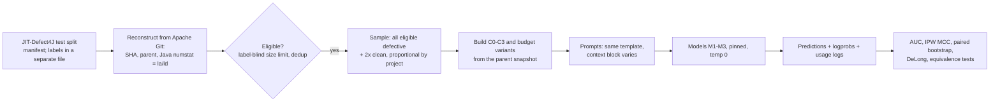

# D. Experimental Design Proposal

Status: **revision 3.1**, 2026-10-19. Revision 3 was written after the Phase 2 critical review and the external audit; 3.1 follows the second external audit: hosted-API models only (user decision), the context rules as implemented in [../src/jitctx/](../src/jitctx/), the split-era confound (L15), and stricter eligibility (§8). Every change and its reason is listed in the [revision log](README.md#revision-log) and the [second audit response](README.md#second-external-audit-response). Nothing has been run on the test split and no LLM has been called. Parameters marked **(pilot)** may be adjusted only with validation-split data, never with test data. Evidence labels: **[V]** verified, **[I]** interpretation or recommendation, **[A]** assumption.

## 0. Design principles

1. **One manipulated factor per contrast.** Every condition shows the identical diff. Context conditions add one separate context block, and only the block's content differs.
2. **Same commits, same model settings, same template** across conditions (a within-subject design).
3. **Separate information from volume.** All context blocks share one token budget, and a token-matched random control is required (see [01-literature-review.md](01-literature-review.md) §7).
4. **Plan for a null result.** Use equivalence tests so that "context does not help" can be a supported conclusion rather than a non-significant one.
5. **Simplest operationalization first.** Git plumbing, tree-sitter-java for method boundaries, and BM25; dependency analysis only if the pilot shows it is needed.
6. **Context is fixed before the call.** One non-agentic prompt per condition, so the effect of *what* the model sees is not mixed up with *how* an agent searches. This is the main methodological difference from JIT-LSM (Huang2026), whose agent chooses its own same-file context ([01-literature-review.md](01-literature-review.md) §5).

## 1. Critique of the provisional research questions

| Provisional RQ | Issue | Refinement |
|---|---|---|
| RQ1: local *or* repository context vs diff only | Two different manipulations in one question, and "effectiveness" is not operationalized. Revision 1 compared each source only with C0, although the brief also asks whether relevant repository context beats *local* code | Three pre-specified contrasts (C1−C0, C2−C0, C2−C1) at one shared token budget, with a named primary metric |
| RQ2: relevant vs random context | Well formed. Two gaps: "relevance" is only as good as the retriever (construct validity), and the token match must be exact per instance | Phrase as *BM25-selected* vs random cross-file context. Add a **manipulation check** and per-instance token matching |
| RQ3: quality, tokens, cost, *and* models | Bundles three questions. The brief names *quantity* as part of the primary independent variable, but revision 1 treated the budget only as an optional ablation | RQ3: quantity and cost (a planned budget series). Model dependence becomes a secondary robustness analysis (SA1), not a research question |
| (missing) | No mechanism: *for which changes* should context help? | Exploratory question EQ1 on change characteristics |

## 2. Refined research questions and hypotheses

- **RQ1 – Context effectiveness and strategy.** Compared with the unified diff alone (C0), how does adding same-file local context (C1) or BM25-selected cross-file repository context (C2) change LLM defect-prediction performance? At an equal token budget, does the BM25 cross-file strategy outperform the proximity same-file strategy?
  - H1a: $\Delta_{AUC}(C1-C0)\neq 0$. H1b: $\Delta_{AUC}(C2-C0)\neq 0$. H1c: $\Delta_{AUC}(C2-C1)\neq 0$. All two-sided, with equivalence bounds $\pm\delta$.
  - H1c compares two *strategies* that differ in pool and in ranking. It is not a test of code location alone (§5.6).
- **RQ2 – Relevance vs volume.** At a per-instance matched token count, does BM25-selected cross-file context outperform randomly selected cross-file context from the same snapshot?
  - H2: $\Delta_{AUC}(C2-C3) > 0$ (reported two-sided).
  - Manipulation check: the relevance proxy is higher for C2 than for C3 (§5.7).
  - Accounting identity, **not a causal decomposition**: $\Delta(C2-C0) = \Delta(C2-C3) + \Delta(C3-C0)$. Read $\Delta(C2-C3)$ as "BM25 versus random selection from the same pool at the same size", and $\Delta(C3-C0)$ as "adding the same amount of randomly chosen code", which mixes extra length with whatever useful information random code happens to carry.
- **RQ3 – Quantity and cost.** How do performance, input tokens, USD cost, and latency change when the cross-file budget grows from 1,000 to 2,000 to 8,000 tokens, for relevance-selected (C2) and random (C3) context? Does the relevance gap C2−C3 grow or shrink with the budget, and what does each +0.01 AUC cost?
- **SA1 (secondary analysis) – Model dependence.** Do the RQ1 and RQ2 effects hold in sign and size for a second, independent model, and for a third if the budget allows? This tests robustness; it is not a research question.
- **EQ1 (exploratory)** – Which change characteristics moderate the benefit of context? Candidates: size, number of files, whether method signatures or public API changed, test-only changes, formatting-only changes, and the size of the same-file pool.

## 3. Pipeline overview



Eligibility (§8) depends only on reconstruction and input sizes. It is computed for every test commit before labels are joined, although its effect on prevalence must be reported.

## 4. Task and prompt

- **Task.** Binary: does the commit introduce a defect that is later fixed, as labelled by `is_buggy_commit`? The unit is one commit.
- **Input scope: Java files except `package-info.java` (a documented scope decision).** The diff and all context use `git diff ... -- '*.java' ':(exclude)*package-info.java'`.
  - Evidence [V, all 27,319 commits]: with this scope Git reproduces the benchmark's `la/ld` for 99.98% of commits in every split. Counting all files matched only 68.5% of a validation sample, and counting `package-info.java` left 195 commits unmatched ([02-datasets.md](02-datasets.md) §2).
  - This shows how the benchmark defines its *change metrics*. It does not show that non-Java changes are irrelevant to the labels.
  - The scope is chosen because it matches the benchmark's definition of the change, JIT-LSM and JIT-Defect-Extended use the same scope, and non-Java text such as `changes.xml` release notes would act like a commit message.
  - Consequence: 31.5% of a validation sample also changed non-Java files that the model never sees [V]. The task is therefore "predict from the Java change", and the thesis must say so.
- **Excluded from all prompts:** commit message, author, dates, JIRA keys, the `classification` and `fix` fields, Kamei metrics, line labels, and every field of JIT-Defect-Extended or JIT-LSM records. File paths stay because they are part of the diff.
  - [I] Rationale: the brief defines C0 as *diff only*; issue keys in messages are a memorization cue; and messages are a known strong predictor that would shrink the headroom for code context.
  - Consequence: absolute results are not comparable with JIT-LSM, whose prompts include the message, author, and date [V, code]. The thesis compares conditions *within* a model, so RQ1–RQ3 are unaffected.
- **Draft template (pilot):**

```text
[system]
You are an experienced Java engineer reviewing a commit. Decide whether the code change
introduces a defect, i.e. a bug that will later have to be fixed.

[user]
### Additional code from the repository (read-only; version BEFORE the change; may be irrelevant)
{context_block or "(none)"}

### Code change (unified diff of .java files, parent -> commit)
{diff}

### Answer
Answer with exactly one word: YES if the change introduces a defect, otherwise NO.
```

- **The block header is identical in every condition.** Each snippet carries its own `// <path> lines a-b` header, so the model can see whether code comes from a changed file or another file.
- **Block order is fixed:** instructions → context → diff → question. The diff sits next to the question in every condition, so the diff-to-question distance stays constant. Within the block, the highest-ranked snippet comes last, next to the diff. [I, motivated by Liu2024]
- **Scoring (validated in the pilot before it becomes primary).**
  - The score is the model's relative likelihood of the two answers at the answer position, $p=\frac{P_{YES}}{P_{YES}+P_{NO}}$, summing case and whitespace variants of each answer.
  - **Both candidates must be measured, not assumed.** A top-k list, even with k ≥ 5, does not guarantee that YES and NO both appear. Acceptable methods, in order of preference:
    1. A hosted API that returns the log-probabilities of both answer tokens at the answer position (exact). Inference uses hosted cloud APIs only; local model hosting is ruled out (user decision, 2026-10-19).
    2. An API with a logit-bias option, applying the *same* bias to exactly the two answer tokens, so both appear in the returned list while their ratio is unchanged [I; must be verified per API].
    3. An API whose top-k list contains both candidates for at least 98% of pilot prompts.
  - The method is fixed per model in the pilot. A response without a valid two-candidate score is **invalid**; it is never recoded as YES or NO in the primary analysis (§11).
  - **Pre-specified fallback:** if M1 gives valid two-candidate scores for fewer than 98% of pilot prompts, the primary metric becomes MCC (IPW) on the binary answers. This is decided and recorded on validation data, before any test-split call.
  - The model's own decision is $\hat y = [p\ge 0.5]$, i.e. its preferred answer. Do **not** tune the threshold on test data.
  - Do **not** use verbalized confidence as a probability (Xiong2024).
- **Rationale subset (pilot, plus 10% of the main run):** a *separate* run in which the answer line becomes "YES or NO on the first line, then ≤ 40 words of justification". The template differs, so these runs are excluded from the confirmatory metrics. Use them only for qualitative error analysis and for the issue-key contamination check (§6).

## 5. Context conditions

Every condition contains the identical C0 diff, `git diff -U3 -M <parent> <commit> -- '*.java' ':(exclude)*package-info.java'`. B is the shared context budget: **2,000 tokens, o200k_base (decision D9)**.

| ID | Context block | Pool (parent snapshot) | Selection | Size |
|---|---|---|---|---|
| **C0** | none | — | — | 0 |
| **C1 local** | Same-file code: the parent version of each changed Java file, with every line already shown in the diff replaced by a marker | Changed files (old paths) | Lines of the enclosing methods first, then by distance from the change | ≤ B |
| **C2 repository, relevant** | 40-line windows from other Java files | Parent `.java` files minus all changed files | BM25 over identifiers in the changed lines | ≤ B |
| **C3 repository, random** | As C2 | As C2 | Seeded uniform random | T(C2) ± 2% |
| C2@b, C3@b (RQ3, M1 only) | As C2 / C3 | As C2 / C3 | As C2 / C3 | b ∈ {1,000; 8,000} |

**Why B = 2,000, and what it costs** [V, all 5,465 validation commits; [04-feasibility-demo.md](04-feasibility-demo.md) §5.6]:

- The masked same-file pool (license header stripped) holds at least 2,000 tokens for 69.4% of validation commits (clean 68.1%, defective 83.5%); at least 1,000 for 81.2%; at least 4,000 for 52.4%; it is empty for 5.1%. In a sample with one third defective commits, C1 can be filled to 2,000 tokens for about 73% of commits and to 1,000 for about 84%. Phase 2's 4-project figures (83–86%) were too optimistic.
- B = 2,000 is kept because the relevance contrast C2−C3 does not depend on the same-file pool, and because the enclosing methods alone had a median of 634 (random) and 1,103 (defective) tokens in the Phase 2 sample. The price is that C2−C1 can be compared at equal size on only about 73% of commits (§5.6, §11). B = 1,000 would raise that share to about 84% but halve the context; this is decision D9.
- Larger cross-file budgets are covered by RQ3.

### 5.1 Rules shared by all context conditions

- **Snapshot.** All code is read from `<parent>` via `git ls-tree -r` and `git cat-file --batch`; no checkout.
- **Preprocessing.** Strip each file's leading license or comment header (everything before `package`; in a default-package file without a `package` line, the leading comments and blank lines) and normalise line endings. The default-package case was found in the 2026-10-20 relevance inspection: a licence block in `src/test/maxima/.../RealFunctionValidation.java` was the top C2 window of a pilot commit.
- **Filling and token accounting** (implemented in [../src/jitctx/select.py](../src/jitctx/select.py) and [../src/jitctx/local.py](../src/jitctx/local.py)). Budgets and matches are counted on the *rendered* block (snippet headers, markers, and code), never as a sum of separately counted snippets, with o200k_base as the reference tokenizer so that every model receives identical text. Provider-reported tokens are logged separately for cost. Units (lines for C1, windows for C2 and C3) are added in rank order. A unit that does not fit is cut at a line boundary; if not even its first line fits, it is **skipped and the next unit is tried** (the second audit showed that stopping there left C2 empty when one huge line ranked first). Each block gets a status:
  - `ok`: within 2% below the target;
  - `line_limit`: below that, and at least one unit could not be fitted (the count of skipped units is logged);
  - `short`: the eligible units ran out without any size failure;
  - `no_hits`: C2 only, no window scored above 0 (C3 is then empty too);
  - `empty_pool`: nothing to select from.

  Tests: [../tests/](../tests/), including the audit's reproduction case.
- **Rendering.** Each C2/C3 snippet is `// <path> lines a-b` followed by the code. Snippets are grouped by file, in line order within a file, and files are ordered so that the file with the best-ranked snippet comes last, next to the diff. C1 lists the changed files in diff order; each run of selected lines has the same header, and each masked run that borders a selected line becomes one marker line, `// <path> lines a-b: shown in the diff`.
- **Empty pools.** If a pool is empty, the block is "(none)" and the instance is flagged, so its prompt equals C0's. This applies to C1 when the changed files are new or already shown in full by the diff (3.5% of random and 5.0% of defective validation commits [V]), and to C2/C3 when every BM25 score is 0.

### 5.2 C1: same-file local context

1. **Masking prevents duplication.** Collect the parent-side line numbers of every hunk in the C0 diff, including the three context lines. These lines are never repeated (marker lines, §5.1).
2. **Enclosing lines** are the lines of the innermost method, constructor, compact constructor, or static or instance initializer that contains a *changed* parent line, found with tree-sitter-java (pinned in [../requirements.txt](../requirements.txt)). Changed parent lines are the deleted lines and, for a pure insertion, the parent lines directly before and after it; context lines do not count, so a neighbouring method is not pulled in just because the diff shows its last lines. For changes outside any method, the enclosing type's header and field declarations come first instead. Git's `--function-context` ranges serve as an independent cross-check **(pilot: manually inspect 30+ diverse changes)**. The Phase 2 sizes below were measured with Git's ranges.
3. **Ranking of the remaining lines:** enclosing lines before all others; then smaller distance to the nearest masked line; then the file order of the diff; then line number.
4. **Fill** to B line by line (§5.1).

Implementation note: Git line numbering splits on LF only, so the builder does too (Python's `splitlines()` also splits on form feeds, which old Apache sources contain, and would shift line numbers).

Examples [V]: for `76c125c3` the masked same-file pool has 5,499 tokens, 3,657 of them inside enclosing methods. For `4063338a` the figures are 2,776 and 268. The measurement code is [feasibility/measure_inputs.py](../feasibility/measure_inputs.py).

### 5.3 Shared cross-file pool (C2, C3)

- **Pool:** all `.java` blobs in the parent tree, excluding every path touched by the commit (old and new names). Test files are included.

  [V] Changed files must be excluded: when the changed file was in the pool, BM25 ranked three same-file windows first, which collapses C2 into local context ([04-feasibility-demo.md](04-feasibility-demo.md) §2).
- **Chunks:** windows of at most 40 lines *and* at most 500 code tokens (line token sums). Consecutive windows start at most 20 lines apart and overlap by half their length, and the last window ends at the file's last line, so every line is covered [V, tested for files of 0–120 lines and with long lines]. A single line longer than 500 tokens forms its own window, flagged `oversized`; it is selected only if it fits **(pilot: compare with method-level chunks)**.

### 5.4 C2: BM25

- **Query:** identifiers from the changed lines (`+` and `-`, excluding diff headers). Split camelCase and snake_case, lowercase, and drop Java keywords and tokens shorter than two characters. Only the diff is used to build the query.
- **Index:** the code lines of each window only. The `// <path> lines a-b` header is rendered but not indexed, so file names do not act as hidden query matches **(pilot: compare with path terms indexed)**.
- **Ranking:** Okapi BM25 ($k_1=1.2$, $b=0.75$) over windows. Ties are broken by (path, start line).
- **Selection:** only windows that score above 0 are eligible. Take them in rank order, skip windows that overlap an already selected window from the same file, and fill to B (§5.1). If the positive-score windows do not fill B, C2 is shorter (`short`) and C3 is matched to C2's actual size. If none exist, C2 and C3 are empty (`no_hits`).
- **Cost:** building the pool and ranking took a median of 0.9 s per commit (maximum 1.7 s; median pool 2,703 windows) on 20 validation commits [V].

### 5.5 C3: random, matched

Same pool and windows as C2.

1. Order the windows by a permutation seeded with `sha256(commit_sha + ":" + seed)`.
2. Fill to $T_{C2}\pm2\%$ with the §5.1 rule. If the gap left is smaller than any snippet header plus one line (headers of deep package paths cost 24–30 tokens), no window fits and C3 ends as `line_limit`, slightly below the band. Such pairs are kept in the primary analysis with their match error and flagged; S3 excludes them. Observed [V, 200 random eligible validation commits, label-free]: 1 of 600 C2/C3 pairs (2.1% below, opennlp at 1,000 tokens).

Overlap with C2 is allowed and is reported. Seed 0 is used for all models; seeds 1–2 are added for M1 only.

### 5.6 Known limits of these operationalizations

- **C1 and C2 differ in pool and in ranking.** C2−C1 therefore compares two practical *strategies* at the same budget, not a pure source effect. A pure source contrast would need a same-file BM25 condition, which is left out to save cost.
- **Local context can run out.** When the masked same-file pool is smaller than B (about 27% of sampled commits at B = 2,000 [V, validation]), C1 has fewer tokens than C2. H1c is therefore tested on the commits whose pool can fill B, a label-blind criterion; the all-commit version is sensitivity analysis S9.
- **Line-based windows do not bound tokens.** In commons-codec, 40-line windows range from a median of 385 to a maximum of 18,761 tokens, because some tests hold long data literals. For `76c125c3`, the top BM25 window held 5,813 tokens, so C2 at B = 2,000 became a single truncated window of Base64 test data [V, [04-feasibility-demo.md](04-feasibility-demo.md) §2]. The builder therefore bounds windows at 500 tokens as well (§5.3); how often oversized single lines occur is logged per commit.
- **C3 is the volume control for C2.** For C1 it is only an approximate volume control, because its code comes from other files.
- **Window boundaries.** 40-line windows cut through methods, equally in C2 and C3.
- **Git's Java function-context heuristic** must be validated (§5.2).

### 5.7 Manipulation check (required for RQ2)

1. **Automated proxy.** The share of selected windows that contain at least one identifier *declared or called* in the changed lines (caller, callee, type definition), compared between C2 and C3. Use a paired Wilcoxon test.
2. **Manual audit.** 30 pilot commits, rated by two raters blind to the condition: "Would this snippet help a reviewer judge the change?" (yes/partly/no). Report Cohen's κ.

If C2 is not clearly more relevant than C3 on the validation split, apply the **pre-specified fallback** before any test run: restrict the pool to files that `git grep -w` finds at `<parent>` for type and method identifiers of the changed lines, rank with BM25 inside that pool, and repeat the check. Record the outcome under decision D9.

## 6. Leakage and validity controls

| # | Control | Implementation |
|---|---|---|
| L1 | Historically valid code only | All repository code is read from `<parent>`. The diff is computed as parent → commit. No later commits, fixes, or reverts are touched |
| L2 | No labels or label metadata in prompts | Message, issue keys, `classification`, `fix`, metrics, line labels, and dates are excluded. The prompt builder reads only Git and the label-free manifest. **It never opens JIT-Defect-Extended or JIT-LSM records**: they embed `is_buggy_commit` and line labels (`added_buggy`), and their folder path (`dataset/buggy/...`) encodes the label [V] |
| L3 | Retrieval query from the diff only | Same as above; no labels in the query |
| L4 | No duplicated content within a prompt | Changed files are excluded from the cross-file pool. Lines shown in the diff are masked in C1 |
| L5 | Identical conditions apart from context | Same template, block header, block order, model ID, parameters, and output constraint |
| L6 | No tuning on test | The template, B, chunking, and parsing are fixed on the validation split. The test split is locked. Pre-register (Git tag or OSF) before test inference |
| L7 | Deterministic exclusion and truncation | Eligibility depends on reconstruction and token counts (§8) and is computed label-blind. The diff is never truncated; context blocks follow the deterministic fill rule (§5.1) |
| L8 | Duplicate and cherry-picked changes | `git patch-id --stable`; keep one instance per patch ID within a split, and exclude any commit whose patch occurs in an earlier split (§8 item 4) |
| L9 | Matched random control | Per-instance token match, same pool, recorded seeds |
| L10 | Contamination (reduced, not excluded) | Exposure cannot be ruled out: the commits and their later fixes have been public since 2001–2019, the benchmark labels since August 2022 (JIT-Fine `data.zip` [V]), and labels with code as plain JSON since July 2025 (JIT-Defect-Extended [V]). Controls: no messages or issue keys in prompts; record each model's training cutoff (an earlier cutoff only avoids the most accessible plain-text copy); a label-recall probe as a *screening* check, whose negative result does not prove absence; flags for rationales that mention an issue key (`[A-Z]+-\d+`) or a later fix; results by commit year; claims limited to "performance on public historical commits". Within-model contrasts are less exposed than absolute performance, because every condition contains the same diff |
| L11 | Project and time effects on baselines | Train baselines on the train split only. Report results per project. Because the split is class-stratified (L15), also report B1–B3 in a strictly chronological re-split of train plus validation (test untouched), where time-dependent features lose much of their apparent value (Kamei LR AUC 0.792 → 0.771 on validation [V]) |
| L12 | Failure accounting | Reason codes for unresolvable commits, API errors, retries, invalid outputs, and empty pools. Analyse the intention-to-treat population plus sensitivity analyses |
| L13 | Time drift not confounded with condition | Randomise the request order across conditions and instances within each model run, and finish each model's run within a short window |
| L14 | Input scope matches the benchmark's change definition | Diffs and context use Java files except `package-info.java`, the scope of the benchmark's `la/ld` [V]. Whether the labels ignore other files is not verified, so the scope is a documented task definition |
| L15 | Split-era confound (*new, second audit*) | The released split is class-stratified, so defective evaluation commits are disproportionately older than clean ones: on validation, commit age alone predicts the label with project-stratified AUC 0.836 [V, [02-datasets.md](02-datasets.md) §2 item 10]. Controls: no dates in prompts (already); report every contrast also *within era strata* (project × period, S11); in the pilot, regress the LLM score on label and commit age to measure era sensitivity per condition; interpret C1−C0 and C2−C0 with this caveat, C2−C3 being protected by design. Whether to draw clean comparison commits time-matched instead is decision D28 |
| L16 | Test-split exposure (*new*) | The test records and statistics already seen are listed in [02-datasets.md](02-datasets.md) §8. None may inform a design choice; the displayed test records are excluded from the confirmatory sample if D27 is approved |

## 7. Models

- **Selection criteria:**
  1. Pinned, dated model version with a **documented training cutoff**.
  2. Context window of at least 32K tokens.
  3. Top-k log-probabilities, required for M1 and M2.
  4. Affordable for the planned calls (§12).
  5. A spread of capability.
  6. Terms of service that allow sending public Apache-2.0 code.
- **Roster** [A; verify availability, cutoffs, and prices when the experiment starts]:
  - **M1 (primary, confirmatory):** an instruction-tuned, non-reasoning model **served through a hosted cloud API** with exact two-candidate scoring (§4), pinned to a dated version. No local model hosting (user decision, 2026-10-19). A hosted open-weight model is acceptable if its API exposes the needed log-probabilities. A training cutoff before July 2025 is preferred, but it is not a contamination guarantee (L10). If no candidate passes the scoring check, the pre-specified MCC fallback applies; local hosting is not a fallback.
  - **M2 (independent second model, SA1):** a hosted model from a different family or provider with valid two-candidate scoring. If it is still offered, `gpt-4o-mini` is a candidate, because JIT-LSM and PROPER-SDP also used it [V].
  - **M3 (optional):** a frontier model, binary output only, on a stratified subsample if the budget allows.
- **Parameters:** temperature 0 (or the provider minimum), top-p 1, minimal `max_tokens` for label-only runs, and a fixed seed parameter if supported. Log the model ID, system fingerprint, request IDs, and timestamps.

## 8. Population, eligibility, sampling, and power

- **Population:** JIT-Defect4J test split, 5,480 commits, 475 defective [V].
- **Eligibility** (label-blind):
  1. Reconstruction passes: SHA and parent exist, and numstat over Java files except `package-info.java` equals `la/ld` (99.98% of commits [V]).
  2. At least one in-scope Java change (2 of 27,319 commits have none [V]).
  3. $T(C0)\le 16{,}000$ tokens (o200k_base) **(decision D4)**.
  4. The patch ID is unique within the split (the earliest commit of a group is kept), and a commit whose patch already occurs in an earlier split (train before validation before test) is excluded, so no evaluated commit was seen by a model trained or tuned on an earlier split: 1 test commit (a validation patch) and, since 2026-10-20, 2 validation commits (training patches, gora) [V; tested in [../tests/test_manifest.py](../tests/test_manifest.py)].
  5. *(Proposed, D27)* The test records displayed during feasibility work ([02-datasets.md](02-datasets.md) §8) are excluded from the confirmatory sample by a documented rule.

  The label-free manifest with these flags is built by `python -m jitctx build-manifest` ([../src/jitctx/manifest.py](../src/jitctx/manifest.py)).

  Evidence [V, all 21 projects; [02-datasets.md](02-datasets.md) §2]: the cap keeps 95.7% of test commits (label-blind). By class, measured on train and validation only, it keeps 85–87% of defective and about 98% of clean commits; 12,000 tokens would keep 80–83% of defective commits and 8,000 only 72–76%. 16,000 is the largest cap that keeps every prompt (diff, 8,000-token RQ3 context, instructions) within a 32K-token window. Expected yield [I]: about 400 eligible defective test commits, if the train and validation retention transfers to the test split.
- **Inference target:** eligible Java changes of the JIT-Defect4J test split, with the benchmark label as an observed, SZZ-derived proxy. Excluded large commits (about 14% of defective ones) are reported in a CONSORT-style flow diagram, by label, and are a stated limitation (Risk 9).
- **Enriched (case-control) sample:**
  - All eligible defective commits (a census).
  - Eligible clean commits sampled with the **same fraction $f$ in every project** (proportional stratification), so that $n_{clean}\approx 2\,n_{def}$.
  - Expected $N\approx 1{,}200$.
- **Weights.** Within each class the sample is self-weighting, so ROC-AUC needs no weights. Precision, F1, and MCC at natural prevalence use $w_{def}=1$ and $w_{clean}=1/f$.
- **Power (primary ΔAUC; a planning approximation, not a guarantee).** With the Hanley–McNeil approximation, AUC = 0.70 [A], $n_{def}=400$, and $n_{clean}=800$ give SE(AUC) ≈ 0.017. For two conditions whose scores correlate with $r$, $SE(\Delta)\approx SE\sqrt{2(1-r)}$.

  | Score correlation r [A] | MDE at α = .05 (80% power) | MDE at Holm's first step (α = .0125) |
  |---|---|---|
  | 0.7 | 0.036 | 0.043 |
  | 0.8 | 0.029 | 0.035 |

  H1c uses only the commits whose same-file pool can fill B (about 335 defective and 545 clean), so its MDE is about 0.040–0.048 at r = 0.7. The number of positives is the binding constraint: raising the clean sample from two to three times the defective count shrinks the SE by only about 4%. Re-estimate $r$ in the pilot. If the MDE exceeds the agreed SESOI, state the limitation rather than adding conditions. For accuracy (McNemar, secondary) the MDE is about 3 percentage points at $N=1{,}200$ and discordance $p_d=0.15$ [A].
- **Development data:** the validation split only. Use 60 commits for the pilot (M1) and at most 200 commits for template iteration.

## 9. Baselines (anchors, not competitors)

| ID | Baseline | Purpose |
|---|---|---|
| B0 | Always clean / always defective | Prevalence reference; AUC = 0.5 |
| B1 | Logistic regression on log(la + ld + 1), trained on the train split (LApredict-style, Zeng2021) | Tests whether the LLM adds more than a size heuristic |
| B2 | Logistic regression on the 14 Kamei metrics in `features_*.pkl`, trained on train | Traditional JIT-DP anchor on the identical sample |
| B3 | JITLine, re-run from the copy in the JIT-Fine replication package (`baselines/JITLine` [V]); CPU only, trained on train, scored on our sample | Supervised code-token anchor on the identical sample |
| B4 | Published JIT-Fine, JIT-Smart, and JIT-LSM results (cited, not re-run) | Context only. Not comparable: different subsets and inputs (messages), and for JIT-LSM an agentic pipeline |
| B5 (optional) | C0 and the best context condition on JIT-LSM's balanced test subset (1,000 commits, 459 defective [V]) that are eligible | Approximate comparability with JIT-LSM, *only if* its paper reports results on that subset |

Exploratory: a logistic regression of the label on the LLM score plus log churn, to test whether the LLM adds predictive value beyond size.

## 10. Metrics

- **Primary (M1): ROC-AUC** of the two-candidate score, *provided* the pilot shows valid scores for at least 98% of prompts; otherwise MCC (IPW) on the binary answers (the pre-specified fallback in §4). Revision 1 used IPW MCC; the reasons for preferring AUC are:
  1. AUC is threshold-free. It measures discrimination and cannot be moved by a context-induced shift in how often the model says YES (Risk 8).
  2. AUC does not depend on class prevalence, so it is unbiased under the case-control sample without weights.
  3. AUC is widely reported in JIT-DP, which helps place the results [BK; confirm in Ni2022 and Chen2024].
- **Key secondary: MCC at natural prevalence** (IPW-weighted confusion matrix) for the model's own decision. It measures the practical yes/no output and is the main metric for models without log-probabilities (M3). MCC uses all four confusion-matrix cells and is recommended for imbalanced binary classification (Chicco2020) and for defect prediction specifically (Yao2020).
  $$MCC=\frac{TP_wTN_w-FP_wFN_w}{\sqrt{(TP_w+FP_w)(TP_w+FN_w)(TN_w+FP_w)(TN_w+FN_w)}},\quad TP_w=\sum_i w_i[y_i=1,\hat y_i=1]\ \text{etc.}$$
- **Secondary:**
  - PR-AUC, precision, and F1 (IPW).
  - Recall, FPR, and balanced accuracy (prevalence-invariant).
  - **Predicted-positive rate** per condition, which detects context-induced bias shifts.
  - Brier score, expected calibration error, and a reliability curve. JIT-DP models are often miscalibrated: ECE ranged from 2% to 35% for three models in Shahini2025 [V, AB].
  - Per-project results: within-project AUC for projects with at least 10 eligible defective commits, and a project-stratified AUC (within-project AUCs weighted by defective count). Pooled AUC can hide between-project differences in base rate and score scale.
  - Effort-aware metrics (Recall@20% effort, Effort@20% recall, with churn as effort) for comparability with the JIT-DP literature.
- **Efficiency:** provider-reported input and output tokens, USD (price table frozen and logged), median and p95 latency, invalid-output rate, API failure rate, and empty-pool rate.

## 11. Statistical analysis plan

1. **Confirmatory family** (M1, seed 0, B = 2,000): {C1−C0, C2−C0, C2−C1, C2−C3}. Holm correction at α = .05, applied to DeLong's test for paired AUCs. C2−C1 is evaluated on the commits whose masked same-file pool can fill B (a label-blind criterion, §5.6); the other three contrasts use all eligible commits.
2. **Unit of inference and project dependence** *(finalized proposal, 2026-10-20; D14)*. The inference target is the eligible commits of the **21 benchmark projects** (§8). The projects are therefore fixed strata, not a random sample, and the confirmatory test (item 1) and its primary CI condition on them. A claim that an effect generalises to *other* projects needs the project-cluster CI below, and is made only if that CI excludes 0 as well. Evidence [V, validation; [../feasibility/split_analysis.py](../feasibility/split_analysis.py) §7]: for the paired ΔAUC of two supervised baselines (B2 − B1 = 0.031), the commit-level CI is 0.022 to 0.039 and the project-cluster CI 0.008 to 0.050, about 2.6 times wider. So project dependence is large, and with 21 clusters the cluster CI is approximate (percentile cluster bootstraps tend to undercover with few clusters [BK]); S4 (leave one project out) is reported alongside.
3. **Estimation:**
   - **Primary CI:** paired bootstrap over commits, stratified by project × label, with 10,000 replicates. Report 95% CIs for every ΔAUC.
   - **Project-generalisation CI:** paired cluster bootstrap over projects (10,000 replicates), for every contrast, plus within-project ΔAUC per project (projects with at least 10 eligible defective commits) and the project-stratified ΔAUC (§10). If pooled and within-project results disagree in sign, report both and give the within-project results priority in the interpretation.
   - Secondary effect sizes, always with CIs: ΔMCC (IPW recomputed in each replicate) and the discordant-pair odds ratio $b/c$ from McNemar's table, with McNemar's exact test.
   - The power figures in §8 are planning approximations for the commit-level test, not guarantees; for project-level generalisation the MDE is roughly 2–3 times larger. Feasibility is judged with the pilot's actual variance.
4. **Equivalence:** the SESOI must be justified and agreed with your supervisor before test inference. Proposed procedure: anchor $\delta$ to a difference the field treats as meaningful, measured on the *validation* split before any test call, for example the AUC gap between the size-only baseline (B1) and the 14-metric baseline (B2) (0.031 on validation [V, [../feasibility/split_analysis.py](../feasibility/split_analysis.py)]), and never below the noise floor (item 5). The 0.03 AUC used in §8 is a placeholder, not a justified value. TOST: equivalence holds only if the 90% CI lies within $\pm\delta$. A non-significant difference with a wider CI is reported as **inconclusive**, never as "no effect". Every contrast is reported as superior, inferior, equivalent, or inconclusive.
5. **Noise floor:** repeat C0 and C2 for M1 on 200 commits with identical settings. Report the flip rate and the repeat ΔAUC distribution (Ouyang2025). Effects within this band are not interpreted.
6. **Invalid outputs:** only transient API failures are retried (at most twice, identical request). Content-invalid responses are neither retried nor recoded. Each contrast is analysed on the commits valid in both of its conditions, and the invalid rate per condition is itself reported as an outcome. S5 bounds the results by scoring invalid responses as YES and as NO.
7. **RQ3 (secondary, estimation):** ΔAUC versus C0 for C2 and C3 at 1,000, 2,000, and 8,000 tokens, with CIs. Pre-specified contrasts: C2@8k − C2@1k, C3@8k − C3@1k, and the change in the relevance gap, (C2−C3)@8k − (C2−C3)@1k. Cost-effectiveness: incremental USD per +0.01 AUC over C0.
8. **SA1:** per-model estimates and CIs, plus sign consistency. Optionally, a mixed-effects logistic model: `correct ~ condition * model + (1|commit) + (1|project)`.
9. **Pre-specified sensitivity analyses:**
   - S1: unweighted MCC on the sample.
   - S2: exclude formatting-only commits (empty `git diff -w --ignore-blank-lines`).
   - S3: exclude instances with an empty pool, and C2/C3 pairs whose C3 is flagged `line_limit` (§5.5).
   - S4: leave one project out.
   - S5: treat invalid outputs as defective vs clean.
   - S6: C3 seeds 1–2.
   - S7: stratify by commit year (contamination). Confounded with the label by the split construction (L15); interpret only within era strata.
   - S8: a high-confidence subset after a manual audit of defective labels (if time allows).
   - S9: C2−C1 on all eligible commits, including those whose C1 block is shorter than B.
   - S10: models with training cutoffs before vs after July 2025 (descriptive).
   - S11: every confirmatory contrast within project × period strata, and with commit age as a covariate (L15).
10. **Exploratory EQ1:** interaction of condition with moderators, labelled as exploratory and not multiplicity-corrected.

## 12. Cost model (RQ3; illustrative)

Measured inputs [V, all train and validation commits under the 16,000-token cap]: the mean T(C0) is 1,777 tokens for clean and 3,860 for defective commits. With one third defective commits in the sample, that gives a mean of about 2,500 tokens. Assumption [A]: $T_{instr}=300$.

| Run | Input tokens per commit | Commits | Input tokens |
|---|---|---|---|
| Core: C0–C3, one C3 seed | $4(300+2{,}500)+3\cdot2{,}000=17{,}200$ | 1,200 | ≈ 20.6M per model |
| M1: C3 seeds 1–2 | $2(300+2{,}500+2{,}000)=9{,}600$ | 1,200 | ≈ 11.5M |
| M1: RQ3 series (C2, C3 at 1k and 8k) | $4(300+2{,}500)+2\cdot1{,}000+2\cdot8{,}000=29{,}200$ | 1,200 | ≈ 35.0M |
| M1: noise floor (C0, C2 repeated) | ≈ 7,600 | 200 | ≈ 1.5M |

M1 needs about **69M** input tokens and M2 about **21M**. Output for label-only runs is negligible.

| Assumed input price (USD per 1M tokens) | M1 | M2 |
|---|---|---|
| 0.20 | ≈ $14 | ≈ $4 |
| 2.00 | ≈ $137 | ≈ $41 |
| 10.00 | ≈ $686 | ≈ $206 |

These are **not price quotes**; freeze the real price list on the run date and reconcile it with the provider's usage records after the pilot. M3 on 600 commits adds about 10M input tokens plus any reasoning output.

## 13. Reproducibility

- Store every prompt (with its SHA-256), raw response, usage, parameters, and timestamps in JSONL. Cache responses by prompt hash.
- Release the instance manifest (SHAs plus eligibility flags) rather than redistributing the data.
- Pin the environment (lock file), version control all code, tag the analysis plan before test inference, and put the prompts in an appendix.
- Follow the reporting items in Wagner2025 and Sallou2024: model versions, configuration, non-determinism, baselines, and artifacts.

## 14. Deliberately out of scope (unless the pilot or your supervisor changes this)

- Fine-tuning.
- Agentic or iterative retrieval. JIT-LSM already covers that direction; this thesis asks which context is worth fetching in the first place.
- Few-shot examples.
- Commit messages or issue text. A message ablation is the most useful later extension, because it would connect the results to JIT-LSM's inputs.
- Multi-language evaluation.
- Combined local + repository conditions, and a same-file BM25 condition (which would give a pure source contrast).

Each would add confounds or cost without answering RQ1–RQ3 more cleanly. If your supervisor wants a causal claim about code *location*, the one justified addition is C1b, same-file code ranked by BM25 (decision D23).
